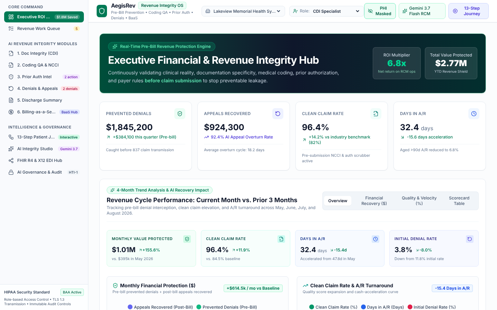

# AI Revenue Integrity Platform

**A prototype for hospitals' billing workflow (the revenue cycle) that uses AI to catch documentation, coding, prior-auth and denial problems *before* a claim goes out.**

Hospitals lose revenue quietly. Notes don't support the codes billed, coding edits get missed, prior authorizations lapse, and denials go unappealed. This prototype puts those checks in one workbench. Each module sends the case to Google Gemini for a structured review and shows the findings, along with an executive view of what was prevented and recovered.



> All organizations, patients and figures in the app are **fictional mock data** (`src/data/mockData.ts`). Nothing connects to a real EHR or payer.

### What it does
- **Executive ROI hub:** prevented denials, appeals recovered, clean-claim rate and days in A/R, plus month-over-month trends and payer performance
- **Revenue work queue:** prioritized items across all modules
- **Six AI review modules**, each backed by its own API endpoint in `server.ts`:
  1. Documentation integrity: finds gaps where clinical notes don't support the coding, and builds the query to send back to the physician (CDI)
  2. Coding QA: checks codes against NCCI edits
  3. Prior authorization evaluation
  4. Denials and appeals: drafts appeal letters
  5. Discharge summary review
  6. Billing-as-a-service view
- **AI financial outlook:** projected KPIs and a next-quarter summary
- Supporting views: a 13-step patient-journey walkthrough, an AI governance and audit log, and an integration hub mock-up (FHIR R4 / X12 EDI)

### Design decisions
- **Resilient AI calls.** Every endpoint goes through `executeAIWithFallback`. It tries a primary Gemini model, then a second Gemini model, then **Groq** (`GROQ_API_KEY`), each with a timeout. If all fail, or no key is set, it returns deterministic built-in results. Every response carries a `source` field saying which one answered. That keeps the demo usable offline and shows which answers came from the model.
- **Structured output only.** Models are asked for JSON (`responseMimeType: application/json`) and the response is parsed before it reaches the UI. Free text is never rendered directly.
- **Review happens before the claim is sent.** The checks run before submission, where fixing a problem is cheap, rather than after a denial.

### Tech stack
TypeScript · React 19 · Vite · Express (`server.ts`) · Tailwind CSS · Recharts · Google Gemini (`@google/genai`) · Groq (fallback)

### Run it locally
```bash
npm install
cp .env.example .env    # set GEMINI_API_KEY and/or GROQ_API_KEY (both optional — without them the deterministic fallback is used)
npm run dev             # http://localhost:3000
```
Production build: `npm run build && npm start`.

### Status
A working prototype on mock data. Started from Google AI Studio tooling, then extended. A real deployment would need EHR/clearinghouse integrations, payer-specific rule sets, PHI handling under a BAA, and validation of the AI reviews by certified coders.

### License
MIT — see [LICENSE](LICENSE).
